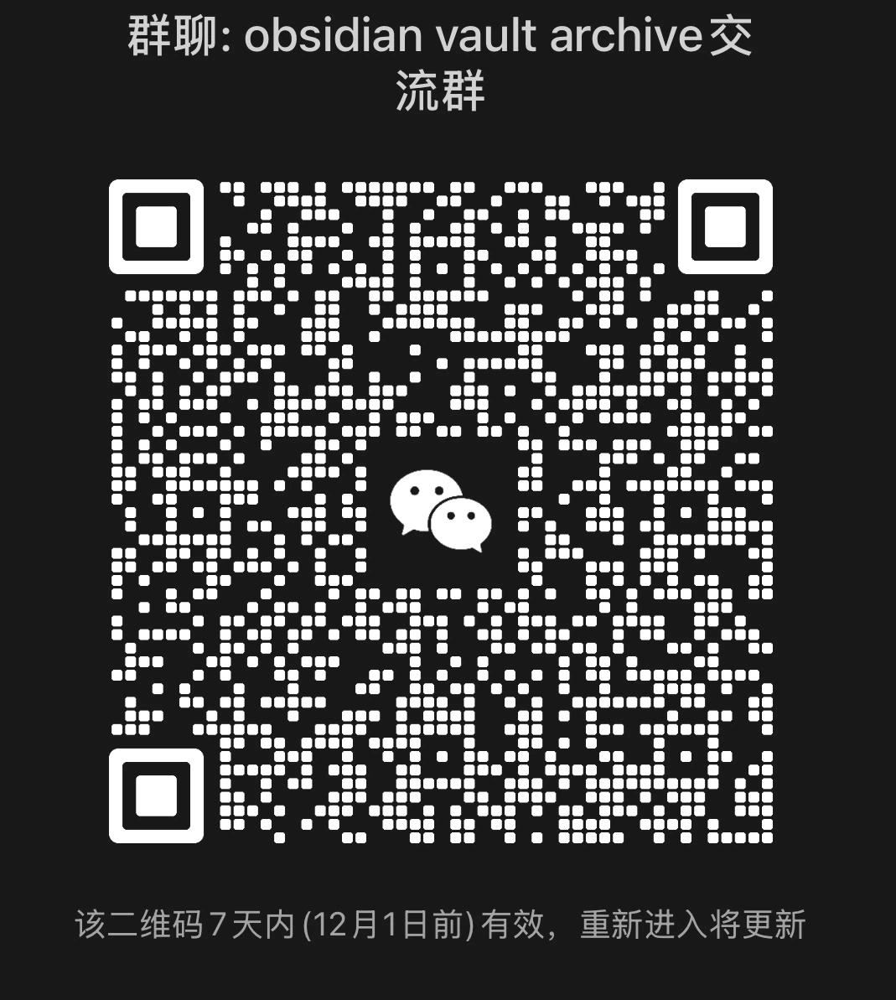

# vault-archive

[English](README.md)

vault-archive 是一个 Obsidian 桌面插件，可以把长期未修改的笔记及其附件归档到另一个 Vault，并保留原有的目录层级。

[下载安装包](https://github.com/FenchD/vault-archive/releases/latest)

## 为什么做这个插件

我的 Obsidian 库积累了很多年的笔记和附件，在手机和几台电脑之间同步越来越慢。手机还会在本地保存整套库，占用不少空间。

我希望把每天用的笔记留在一个较小的 Vault，把历史内容按需分到独立的归档 Vault。这样日常同步的数据更少，手机只同步日常库也能省下存储空间。需要翻旧资料时，直接在 Obsidian 打开对应的归档库，沿着熟悉的目录就能找到笔记和附件。

## 安装

支持 Windows 和 macOS 桌面版，要求 Obsidian 1.5.0 或更高版本。

1. 从 [Releases](https://github.com/FenchD/vault-archive/releases/latest) 下载 `vault-archive-<version>.zip`。
2. 解压后，将整个 `vault-archive` 文件夹放入**要整理的源库**的 `.obsidian/plugins/`。如果 `plugins` 目录还没有，可以先创建。最终路径应为 `<源库>/.obsidian/plugins/vault-archive/main.js`。
3. 重新打开源库，在 **设置 → 第三方插件** 中启用 **vault-archive**。

升级时，先完成正在进行的归档，再禁用插件。将新版安装包内的文件覆盖到原插件目录，保留 `data.json`，然后重新启用。

## 第一次归档

1. 准备一个独立的归档文件夹。它可以与源库并列，例如 `Notes` 与 `NotesArchive`。两个目录不能互相嵌套。
2. 打开 **设置 → vault-archive**，在 **目标归档 Vault** 下点 **选择文件夹…**。默认按文件的最后修改时间筛选两年以上未改动的笔记，可把阈值改为指定的年数或天数。
3. 按需设置 **忽略目录** 和 **忽略文件类型**。任意层级以点开头的目录（如 `.obsidian`）会自动排除。
4. 点击 **查看归档预览**，或从命令面板运行 **vault-archive: 执行归档（先核对清单）**。核对文件、附件和冲突后，点击 **执行本次归档**。首次使用建议先备份，归档期间暂停同步和其他编辑。
5. 在 Obsidian 的库选择界面把归档文件夹作为 Vault 打开，即可浏览归档内容。

## 归档时会发生什么

- 归档的 Markdown 笔记及其附件保留原相对路径，笔记正文保留原样。链接到其他笔记时，那些笔记仍各自按归档规则筛选。
- 如果源库保留的笔记仍引用某个附件，插件会给归档库留一份并保留源库副本。跨库笔记链接可能无法从当前库直接解析，归档报告会列出这些链接和缺失的附件。
- 插件校验整批归档副本后才移除源文件。归档报告、恢复记录和覆盖前的备份位于目标库的 `.vault-archive` 目录。归档中断或推送失败时，可从命令面板运行 **vault-archive: 继续上次归档或重试 Git 推送**。

## 可选设置

- **启动行为**默认关闭。可选择**延迟预览**或**延迟自动归档**。后者会直接归档符合条件的项目。
- 在**高级选项**中可开启**删除归档后变空的文件夹**。默认关闭，开启后清理本批操作留下的空源目录。
- 开启**归档后 Git 提交并推送**前，请确保桌面端能运行 Git，归档库的根目录是一个工作区干净的 Git 仓库，当前分支已配置远程跟踪分支（upstream），并已配置提交作者和推送凭证。

## 免费使用与许可

vault-archive 是闭源项目。插件的全部功能均可免费使用，无需注册插件账号。使用许可和第三方声明见 [LICENSE](LICENSE) 和 [THIRD-PARTY-NOTICES.txt](THIRD-PARTY-NOTICES.txt)。

## 文件访问与网络连接

- 插件读取源库中的笔记及附件，并写入你选择的独立归档目录。校验归档副本后，插件会移除对应的源文件。启用空目录清理后，也会删除本批归档留下的空目录。
- 归档在本地进行，插件不收集遥测数据。启用 Git 推送后，插件会调用本机 Git，将归档提交发送到归档库当前分支配置的远程 Git 仓库。

## 反馈与交流

如果遇到问题，或希望支持某种归档场景，欢迎提交 Issue，也可以用微信扫下方二维码加我交流。我会根据反馈和实际使用需求更新插件。[提交 Issue](https://github.com/FenchD/vault-archive/issues)

